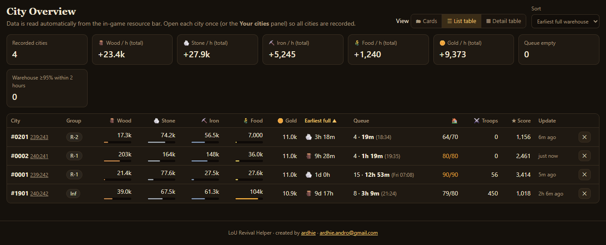
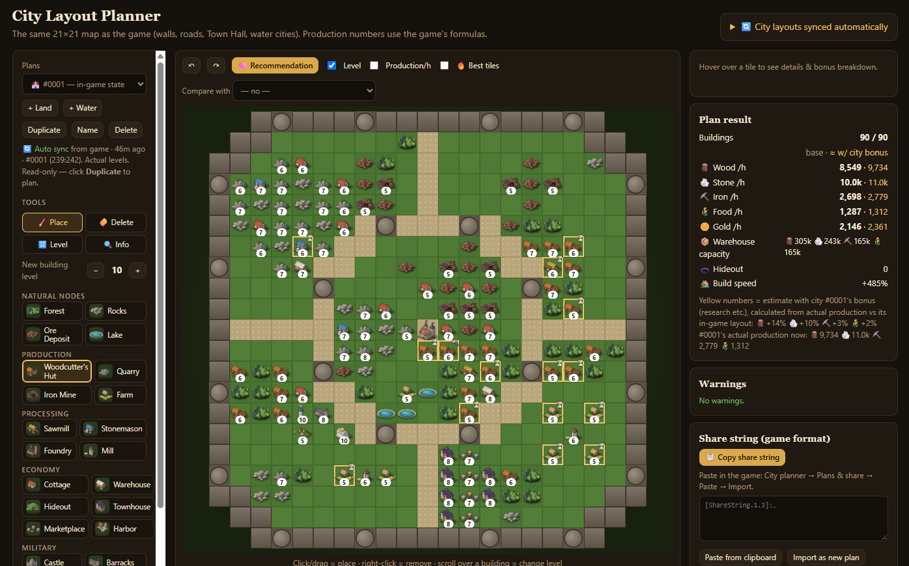
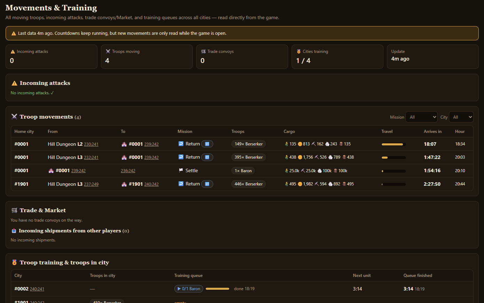

# LoU Revival Helper (Chrome extension)

🇮🇩 Bahasa Indonesia · [English](README.md)

Versi 1.13.0 · dibuat oleh **ardhie** · ardhie.andro@gmail.com

Alat bantu untuk **Lord of Ultima: Revival** (lordofultima.me):

1. **Ringkasan Kota**: resource, kapasitas, produksi/jam, kapan gudang penuh atau makanan habis, dan status antrian bangunan semua kota. Dilengkapi notifikasi desktop dan rencana **🔁 Transfer** yang menyarankan kiriman resource antar-kota (jumlah, gerobak, waktu tempuh).
2. **Perencana Layout**: peta 21×21 yang sama dengan game (tembok, menara, jalan, Town Hall, kota air). Produksinya dihitung dengan rumus resmi game. Layout kota yang sedang aktif tersinkron otomatis dari game, lengkap dengan level asli dan antrian bangunan (share string dari City planner juga diterima). Ada **🧠 Rekomendasi** (optimizer yang menyusun bangunan produksi, pengolahan & Cottage di sekitar node alam untuk produksi terbesar: kayu/batu/besi/makanan maksimal, seimbang, atau rasio kustom; opsional boleh menghapus node alam bila tiap node menambah produksi di atas ambang), heatmap "petak terbaik", perbandingan rencana vs kota (apa yang perlu dibangun/dibongkar), level per bangunan, **📋 langkah pembangunan** (apa yang dibongkar/dibangun/di-upgrade, berurutan, dengan biaya & waktu), undo/redo, dan ekspor share string yang bisa langsung di-*Import* di game.
3. **Pergerakan**: semua pasukan yang bergerak (raid/return/attack/support…, muatan, hitung mundur), ⚠️ serangan masuk (notifikasi desktop), konvoi dagang/Market (keluar, kembali, kiriman masuk), dan antrian pelatihan pasukan + pasukan di tiap kota.
4. **Dungeon & Boss**: semua dungeon/boss yang dimuat peta Region tersimpan otomatis (level & explored %); guardians/max loot terisi saat panelnya dibuka. Ada filter, jarak ke kota terdekat, kalkulator raid (unit angkut, waktu tempuh, loot per jam), dan catatan/statistik raid. **🎯 Raid Planner**: pilih kota, lalu dapatkan dungeon terdekat yang cocok dengan pasukannya, jumlah pasukan per dungeon (rumus Revival), loot per jam, dan berapa raid sampai explored 100% — pasukan dibagi otomatis. Daftar dungeon menandai yang sedang diraid, perkiraan explored % terkini, dan skor ⭐ prioritas.
5. **📈 Statistik**: loot raid per hari & per kota, produksi total, skor, dan pasukan per kota dari waktu ke waktu (dicatat tiap jam).
6. **👥 Pemain**: pemain & aliansi yang terlihat di peta, status hubungan & catatan, serta riwayat serangan masuk per pemain.
7. **📜 Cheat Sheet**: tab *Dungeons*, *Bosses*, *Recruit %*, *Troops Stats*, dan *Layouts* (layout kota militer Land & Sea/Water). Isinya jumlah pasukan minimum/rekomendasi untuk tiap tipe & level dungeon dan boss (dihitung dari rumus game Revival, termasuk Explored %), kalkulator raid & boss (kerugian, loot, peluang kill), kecepatan rekrut per unit (recruit speed % kota terisi otomatis dari layout yang tersinkron), dan statistik semua unit. **🧱 Buildings** (biaya & waktu bangun tiap level dengan kecepatan bangun kotamu) dan **⚔️ Battle** (simulator serangan/pertahanan dengan aturan game). Tabel cheat sheet komunitas (LoU klasik) juga tersedia sebagai referensi.

## Pratinjau

**Ringkasan Kota — tabel list**

**Perencana Layout — layout kota tersinkron dari game dengan level asli**

**Pergerakan & Pelatihan**

## Cara pasang
1. Ekstrak ZIP ke sebuah folder.
2. Buka `chrome://extensions`, lalu nyalakan **Developer mode** (pojok kanan atas).
3. Klik **Load unpacked**, lalu pilih folder `lou-helper`.
4. Pin ikon kastil di toolbar. Buka/refresh tab game.

## Cara pakai
- **Data kota:** buka game dan pindah ke tiap kota sekali. Buka juga daftar kota (klik nama kota di kiri atas) supaya semua kota tercatat.
- **Jam selesai antrian:** buka panel *Construction* sekali per kota.
- **Dungeon:** tab *Region*, lalu klik ikon dungeon atau boss. Akan muncul pesan kecil "Disimpan".
- **Layout kota:** otomatis untuk semua kota sekaligus. Layout-nya muncul di Perencana Layout sebagai "🏰 nama kota — kondisi di game" (hanya-baca). Klik *Duplikat* untuk membuat rencana yang bisa diedit.
- Dashboard bisa dibuka lewat popup ikon extension, atau klik kanan ikon lalu pilih *Options*.

## Bahasa
Pengaturan → 🌐 Bahasa: Bahasa Indonesia, English, Español, Français, Deutsch, Italiano, Magyar, Ελληνικά, atau **Ikuti bahasa game** (otomatis memakai bahasa yang dipilih di game). Nama bangunan & istilah game tetap memakai nama dari game.

## Ikon bangunan
Ikon & nama bangunan di Perencana Layout diambil dari game saat kamu membuka **Build bar**, **Guide → Your city & the grid** (node alam), dan panel **Town Hall**. Ikon disimpan lokal di browser (tidak dibundel di extension); sebelum tertangkap, emoji dipakai sebagai cadangan.

## Keamanan
Extension ini hanya **membaca** data yang sudah ada di halaman game (teks di layar dan data kota yang sedang ditampilkan). Extension tidak mengklik apa pun, tidak mengirim perintah ke server game, dan tidak mengotomasi aksi. Semua data disimpan lokal di `chrome.storage` di browser kamu.

## Catatan
- Layout dari share string tidak membawa level (dianggap level 10); layout sinkron otomatis memakai level asli. Bonus riset diperkirakan dari produksi nyata kota.
- Daya angkut, kecepatan dasar, dan kekuatan unit di Pengaturan diambil dari data game Revival. Menit/field dikalibrasi otomatis dari pergerakan pasukanmu (bisa dimatikan di Pengaturan).
- Data kota dibaca tanpa bergantung bahasa game: resource, antrian, dan pasukan semua kota dari data game; produksi/jam & kapasitas dari resource bar kota aktif.
- Kalau tampilan game berubah (update), pembaca data mungkin perlu disesuaikan. Logikanya ada di `content.js`.

## Credit
- Dibuat oleh **ardhie** — ardhie.andro@gmail.com
- Saran, laporan bug, atau ide fitur: kirim email dan sertakan versi extension.
- LoU Revival Helper adalah alat buatan pemain dan tidak berafiliasi dengan pengembang *Lord of Ultima: Revival*. Nama game, ikon, dan aset lainnya milik pemiliknya masing-masing.

## Change Log
Lihat [CHANGELOG.id.md](CHANGELOG.id.md), atau tab **ℹ️ Tentang → 📝 Change Log** di dashboard.
